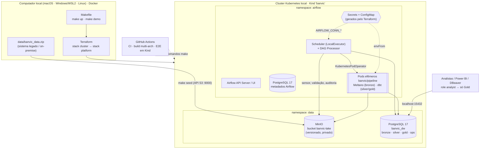
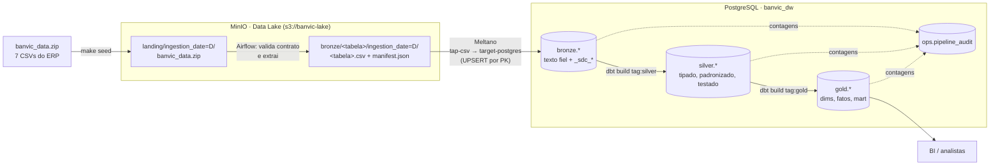
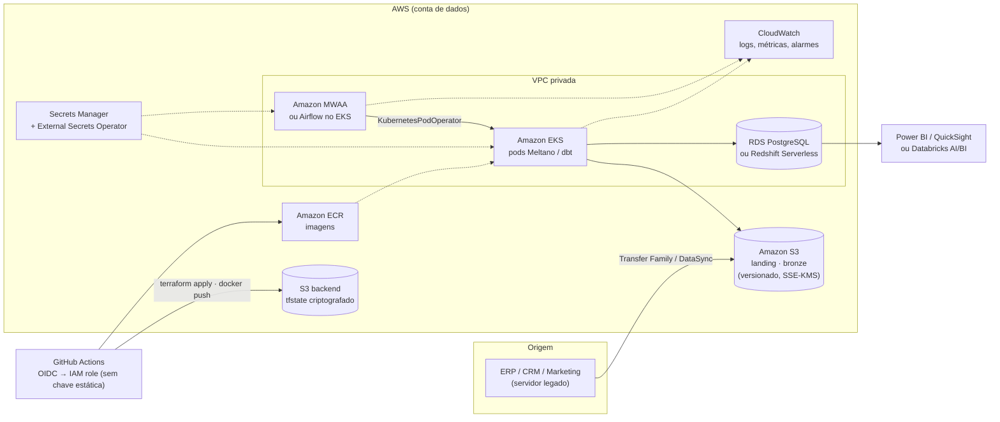

# BanVic Data Platform — POC de Infraestrutura e Ingestão (Arquitetura Medalhão)

[](../../actions/workflows/ci.yml)
[](../../actions/workflows/e2e-kind.yml)

Prova de conceito para o **Banco Vitória S.A. (BanVic)**: um ambiente 100% local e reprodutível,
provisionado com **Terraform** em um cluster **Kubernetes (Kind)**, que ingere as 7 tabelas do ERP
(`banvic_data.zip`) e as organiza em camadas **Landing → Bronze → Silver → Gold** para consumo
centralizado por analistas e ferramentas de BI.

| Pergunta | Resposta curta |
|---|---|
| Como subo tudo? | `make up` (cluster + imagens + plataforma) |
| Como rodo o pipeline? | `make demo` (envia o arquivo, roda a DAG, valida os dados) |
| Onde vejo? | Airflow `localhost:8080` · MinIO `localhost:9001` · Postgres `localhost:15432` |
| Tem custo de nuvem? | Não. Tudo roda no seu computador (Docker + Kind). |
| Onde estão as senhas? | Em lugar nenhum do Git: o Terraform gera, o Kubernetes guarda (`make credentials`). |

> Preparar o computador: **[macOS](docs/setup/macos.md)** · **[Windows (WSL2)](docs/setup/windows-wsl2.md)** · **[Linux](docs/setup/windows-wsl2.md#linux-nativo)**  
> Guia de execução fase a fase, com testes de cada etapa: **[docs/GUIA_PASSO_A_PASSO.md](docs/GUIA_PASSO_A_PASSO.md)**

---

## 1. Arquitetura

### 1.1 Infraestrutura



### 1.2 Fluxo de dados (medalhão)



### 1.3 A DAG `banvic_medallion`

```
resolve_ingestion_date                       param > logical_date > run_after (UTC)
  └─ landing ─────────────────────────────────────────────────────────────────────
       wait_for_landing_file    S3KeySensor (reschedule, backoff, timeout 6h)
       landing_to_bronze        valida contrato do zip (colunas, linhas, sha256),
                                publica bronze/<tabela>/ingestion_date=D/ + manifesto
  └─ bronze ──────────────────────────────────────────────────────────────────────
       bronze_pod_arguments     gera 1 conjunto de argumentos por tabela
       load_bronze [x7]         KubernetesPodOperator (dynamic task mapping, máx. 3 em paralelo)
       bronze_quality           linhas carregadas == linhas do manifesto → ops.pipeline_audit
  └─ silver ──────────────────────────────────────────────────────────────────────
       dbt_silver               KubernetesPodOperator: dbt build --select tag:silver
  └─ gold ────────────────────────────────────────────────────────────────────────
       dbt_gold                 KubernetesPodOperator: dbt build --select tag:gold
       audit_layers             contagens Silver/Gold → ops.pipeline_audit
```

### 1.4 Camadas

| Camada | Onde | Conteúdo | Quem escreve | Quem lê |
|---|---|---|---|---|
| Landing | MinIO `landing/` | O zip exatamente como chegou | Sistema legado (`make seed`) | Airflow |
| Bronze (lake) | MinIO `bronze/` | CSVs extraídos por partição de data + manifesto (contagens, sha256). Histórico imutável e versionado | Airflow | Meltano |
| Bronze (DW) | `bronze.*` | Espelho fiel da origem (tudo texto) + metadados `_sdc_*` (arquivo/partição de origem, linha, horários de carga) | `svc_ingestion` (Meltano) | dbt, Airflow |
| Silver | `silver.*` | Tipos reais (`timestamptz`, `numeric(18,2)`), CPF/CEP normalizados, deduplicado, testado | `svc_transform` (dbt) | Engenharia |
| Gold | `gold.*` | `dim_agencia`, `dim_colaborador`, `dim_cliente`, `fct_transacoes`, `fct_propostas_credito`, `mart_cliente_mensal`. **Sem PII** | `svc_transform` (dbt) | `analyst` (BI) |
| Ops | `ops.pipeline_audit` | Contagem por camada/tabela em cada execução | `svc_orchestrator` (Airflow) | Engenharia |

---

## 2. Stack e decisões de arquitetura

| Componente | Escolha | Por quê | Alternativa considerada |
|---|---|---|---|
| IaC | **Terraform** (2 stacks: `cluster` e `platform`) + módulos reutilizáveis (`postgres`, `minio`) | Provisiona do zero e de forma declarativa: cluster, namespaces, Secrets, StatefulSets, Jobs e o Helm do Airflow. Duas stacks evitam o anti-padrão de `-target` (o provider Kubernetes precisa do cluster pronto no `plan`) | Manifestos YAML + `kubectl apply` (menos reprodutível, sem estado) |
| Kubernetes local | **Kind** (1 nó, imagem fixada por digest) | Mesmo cluster no laptop e no runner do GitHub Actions → E2E reprodutível | Minikube (mais pesado no Apple Silicon) |
| Orquestração | **Airflow 3.2** (chart oficial 1.22) com **LocalExecutor + KubernetesPodOperator** | O Airflow só orquestra; o trabalho pesado roda em pods isolados com imagem própria (dependências não conflitam, falha não derruba o scheduler) | CeleryExecutor (Redis + workers: mais RAM sem ganho aqui) |
| Ingestão (EL) | **Meltano** (`tap-csv` → `target-postgres`, MeltanoLabs) | Taps/targets declarativos, PKs no `meltano.yml`, UPSERT idempotente, metadados de linhagem; plugins definidos inline (sem depender do Meltano Hub no build) | Embulk (JVM, ecossistema menor) |
| Transformação | **dbt Core** (adapter Postgres) | SQL versionado + testes declarativos (unique, not_null, relationships, accepted_values) que viram o *quality gate* entre camadas | SQL solto executado pelo Airflow (sem testes nem linhagem) |
| Data Lake | **MinIO** (API S3) | Zona de landing/bronze imutável e versionada, mesma API do S3 (migração direta para AWS) | Filesystem montado (sem API S3, sem versionamento) |
| DW | **PostgreSQL 17** | "DW simulado" pedido pelo desafio; conecta direto no Power BI | DuckDB/Iceberg (exigiria catálogo e engine extra) |
| CI/CD | **GitHub Actions** | Lint, testes de DAG, pipeline de dados contra Postgres real, validação de IaC/manifestos, varredura de segredos, build multi-arch e E2E em Kind | — |

**Nota de governança — MinIO:** a edição Community do MinIO parou de publicar imagens em out/2025, o
repositório foi arquivado em 2026 e, em set/2026, a MinIO **removeu `minio/minio` e `minio/mc` do Docker Hub**
(o `quay.io/minio` passou a exigir login). Além disso, a última versão community tem vulnerabilidade
conhecida (CVE-2026-40344). Por isso a POC usa as imagens **mantidas pela Chainguard**
(`cgr.dev/chainguard/minio` e `minio-client`): recebem patches de segurança, são multi-arch e rodam como
não-root. Como o plano gratuito só publica a tag `latest`, elas são **fixadas por digest** (`@sha256:...`),
o que é ainda mais reprodutível que uma tag de versão. Em produção, a recomendação é **Amazon S3**
(seção 10) ou um substituto mantido (SeaweedFS, Garage, Ceph RGW). Como o pipeline usa apenas a API S3,
a troca não exige mudança de código.

---

## 3. Quickstart

**Pré-requisitos:** Docker com **≥ 8 GB de RAM** (ideal 10 GB) e as CLIs `terraform`, `kind`, `kubectl`,
`aws`, `jq` e `unzip` (mais `uv` para lint e testes). Instalação passo a passo por sistema:

| Sistema | Guia | Resumo |
|---|---|---|
| macOS (Apple Silicon ou Intel) | [docs/setup/macos.md](docs/setup/macos.md) | Docker Desktop + Homebrew |
| Windows 10/11 | [docs/setup/windows-wsl2.md](docs/setup/windows-wsl2.md) | Docker Desktop + **WSL2 (Ubuntu)**; os comandos rodam no terminal do Ubuntu |
| Linux (Ubuntu/Debian) | [docs/setup/windows-wsl2.md#linux-nativo](docs/setup/windows-wsl2.md#linux-nativo) | Docker Engine + apt |

Com as ferramentas instaladas (`make check` confere tudo):

```bash
git clone https://github.com/LLR798/banvic-data-platform.git
cd banvic-data-platform

make check         # ferramentas, Docker e memória
make up            # ~10-15 min na 1ª vez: cluster Kind + imagens + MinIO + Postgres + Airflow
make credentials   # URLs e senhas geradas pelo Terraform
make demo          # envia o zip, roda a DAG e valida os dados (~5 min)
```

| Serviço | Endereço | Usuário |
|---|---|---|
| Airflow UI | http://localhost:8080 | `admin` (senha em `make credentials`) |
| MinIO Console | http://localhost:9001 | `lake-admin` |
| Postgres DW (Gold) | `localhost:15432` / banco `banvic_dw` | `analyst` (somente leitura da Gold) |

Outros comandos: `make help` · `make status` · `make logs` · `make psql` · `make validate` · `make down`.

Reprocessar uma data específica: `make demo INGESTION_DATE=2026-10-13` (ou, na UI, *Trigger DAG* com
`{"ingestion_date": "2026-10-13"}`).

---

## 4. Estratégia de ingestão

### 4.1 Fonte e contrato

O `banvic_data.zip` simula a exportação diária de um sistema legado. Antes de qualquer carga, a task
`landing_to_bronze` valida o arquivo contra o **contrato** em [`dags/banvic/contracts.py`](dags/banvic/contracts.py):

- as 7 tabelas esperadas estão presentes (nem faltando, nem duplicadas);
- o cabeçalho de cada CSV é **exatamente** o esperado (mudou coluna no legado → falha aqui, não no meio do DW);
- nenhum CSV está vazio; contagem de linhas e **sha256** vão para o manifesto;
- proteções contra *zip-slip* e *zip-bomb*.

Violação de contrato lança `AirflowFailException`: **não há retry** (reprocessar o mesmo arquivo ruim não
resolve), e o alerta sai na hora.

### 4.2 Bronze (Meltano)

| Decisão | Implementação |
|---|---|
| Extractor | `tap-csv` (MeltanoLabs) com as 7 entidades e suas **PKs** declaradas em [`ingestion/meltano/meltano.yml`](ingestion/meltano/meltano.yml) |
| Loader | `target-postgres` no schema `bronze`, com `add_record_metadata: true` e `validate_records: true` |
| Tipos | Tudo **texto** na Bronze (cópia fiel; nada é perdido por conversão). A tipagem é responsabilidade da Silver |
| Estratégia de carga | **UPSERT por chave primária** (`load_method: upsert`): a origem é um snapshot completo, então a reexecução atualiza em vez de duplicar |
| Linhagem | `_sdc_source_file` registra a partição do lake (`.../ingestion_date=D/tabela.csv`); `_sdc_batched_at`, `_sdc_extracted_at` registram quando |
| Paralelismo | 1 pod por tabela (*dynamic task mapping*), máx. 3 simultâneos; falha em `transacoes` reexecuta só `transacoes` |
| Integridade da carga | `bronze_quality`: linhas carregadas da partição **==** linhas do manifesto, senão a DAG falha |

### 4.3 Silver e Gold (dbt)

- **Silver**: um modelo por tabela; `timestamptz` (a origem traz `... UTC` com 0–6 casas decimais),
  `numeric(18,2)` (remove ruído de ponto flutuante), CPF/CEP só dígitos (CEP vinha em 2 formatos),
  deduplicação defensiva por PK. `transacoes` é **incremental** (`delete+insert` por `cod_transacao`,
  com janela de *lookback* de 3 dias).
- **Testes** (40 na Silver, 24 na Gold): PK única e não nula, integridade referencial, valores aceitos e
  reconciliação Bronze × Silver. `severity: error` interrompe a DAG antes da Gold.
- **Problema real encontrado na origem:** o `cod_cliente = 528` tem 1 conta e 4 propostas, mas **não existe**
  em `clientes`. Na Silver isso é um **WARN** (registrado, não bloqueia). Na Gold, `dim_cliente` recebe um
  membro *"CLIENTE NÃO IDENTIFICADO"* para que nenhum fato se perca nos joins do BI.
- **Gold** pensada para a Diretoria Comercial: `mart_cliente_mensal` (cliente × mês, com meses sem
  transação zerados) traz quantidade de transações, janela móvel de 3 meses, recência e status
  (`ativo`, `inativo_no_mes`, `risco_churn`, `sem_historico`). A recência é medida contra a última data da
  base (jan/2023), não contra hoje.

### 4.4 Idempotência

| Camada | Mecanismo | Reexecutar o mesmo dia… |
|---|---|---|
| Landing/Bronze (lake) | Sobrescreve o prefixo `ingestion_date=D` (bucket versionado guarda as versões) | … gera o mesmo conteúdo |
| Bronze (DW) | UPSERT por PK | … não duplica linhas |
| Silver | `table` (recriada) e `incremental delete+insert` por PK | … não duplica linhas |
| Gold | `table` (recriada) | … recalcula |
| Auditoria | `INSERT ... ON CONFLICT (run_id, layer, table_name) DO UPDATE` | … atualiza o registro |

O CI prova isso: o job `data-pipeline` roda a carga **duas vezes** e valida as contagens; o E2E roda a
**DAG duas vezes** para a mesma data e valida de novo.

---

## 5. Orquestração, resiliência e monitoramento

- **Retries com backoff exponencial**: 3 tentativas, ≈30 s → 60 s → 120 s (com jitter, teto 10 min), em todas as tasks
  que tocam rede/banco.
- **Falhas não-retentáveis** (contrato violado, divergência de contagem) usam `AirflowFailException`.
- **Sensor em `mode="reschedule"`** com backoff: espera o arquivo sem ocupar slot de execução.
- **Timeouts**: `execution_timeout` (30 min/task), `dagrun_timeout` (2 h), timeout do sensor (6 h).
- **Concorrência**: `max_active_runs=1` (sem corrida entre dias) e `max_active_tis_per_dagrun=3` nos pods.
- **Callbacks**: falha/retry de task e falha/sucesso da DAG geram log estruturado; se
  `BANVIC_ALERT_WEBHOOK_URL` estiver definido (Slack/Teams via Secret), o alerta também é enviado.
- **Pods**: sucesso → removido; falha → mantido para inspeção (`on_finish_action="delete_succeeded_pod"`),
  com eventos do Kubernetes anexados ao log.
- **Observabilidade de dados**: `ops.pipeline_audit` (contagem por camada a cada execução),
  `manifest.json` no lake e `run_results.json` do dbt publicados em `s3://banvic-lake/ops/dbt_artifacts/`.
- **Assets do Airflow 3**: as tasks de carga declaram `outlets`, criando linhagem na UI e permitindo
  disparar DAGs consumidoras (ex.: refresh do BI) quando a Gold for atualizada.

---

## 6. Segurança e governança

| Controle | Como |
|---|---|
| Nenhuma credencial no código | Senhas geradas por `random_password` no Terraform → Kubernetes Secrets → `envFrom`/`AIRFLOW_CONN_*`. `meltano.yml`, `profiles.yml`, DAGs e values do Helm só referenciam **nomes** de Secrets/variáveis. O CI roda **Trivy** para detectar segredos commitados |
| Menor privilégio no DW | 4 roles: `svc_ingestion` (escreve Bronze), `svc_transform` (lê Bronze, escreve Silver/Gold), `svc_orchestrator` (lê tudo, escreve `ops`), `analyst` (lê **só a Gold**). `make validate` comprova que `analyst` é bloqueado na Silver |
| Menor privilégio no lake | Aplicações usam o usuário `svc-pipeline` com política restrita ao bucket; a credencial root do MinIO só é usada pelo Job de setup. Bucket privado e versionado |
| Credencial por job | Pod de Bronze recebe só a senha de `svc_ingestion`; pods dbt só a de `svc_transform` |
| LGPD / PII | CPF, e-mail e endereço ficam na Silver (acesso de engenharia). A Gold não tem PII |
| Rede | Portas expostas apenas em `127.0.0.1` (não acessíveis pela rede local) |
| Containers | Pods do pipeline rodam como não-root (UID 10001), sem escalonamento de privilégio e com `capabilities: drop ALL` |
| Supply chain | Imagens com versões fixadas (nó do Kind e MinIO por **digest**); MinIO de fonte mantida (Chainguard) após a remoção das imagens oficiais; GitHub Actions fixadas por **SHA** de commit |
| Estado do Terraform | `terraform.tfstate` contém as senhas: fica local e está no `.gitignore` (em produção: backend S3 criptografado) |

---

## 7. CI/CD (GitHub Actions)

| Workflow | Gatilho | Jobs |
|---|---|---|
| [`ci.yml`](.github/workflows/ci.yml) | push/PR | **lint** (ruff, yamllint) · **dag-tests** (DagBag sem erros, dependências na ordem do medalhão, sem ciclos, retries/backoff/callbacks, credenciais só via Secrets) · **data-pipeline** (bootstrap do DW + Meltano + dbt contra um Postgres real, 2× para provar idempotência, + `validate.sql`) · **terraform** (fmt, validate, tflint) · **k8s-manifests** (`helm template` do Airflow com nossos values → `kubeconform`) · **security** (Trivy secret scan) |
| [`build-images.yml`](.github/workflows/build-images.yml) | mudanças em código/Dockerfiles | Build **multi-arch** (amd64 + arm64) das imagens Airflow e pipeline; em `main`/tags publica no GHCR |
| [`e2e-kind.yml`](.github/workflows/e2e-kind.yml) | PR para `main` / manual | Sobe a stack inteira **do zero** num Kind efêmero no runner com `make up`, roda `make demo`, reexecuta (idempotência), coleta diagnóstico se falhar e destrói |

---

## 8. Estrutura do repositório

```
banvic-data-platform/
├── .github/workflows/          ci.yml · build-images.yml · e2e-kind.yml
├── infra/
│   ├── terraform/
│   │   ├── cluster/            stack 1: cluster Kind (portas, nó fixado por digest)
│   │   ├── platform/           stack 2: namespaces, Secrets, MinIO, Postgres x2, Airflow (Helm)
│   │   └── modules/            postgres/ (StatefulSet+PVC+Service) · minio/ (StatefulSet+Job de setup)
│   └── helm/                   airflow-values.yaml.tftpl
├── docker/
│   ├── airflow/                imagem Airflow 3.2.2 + providers + DAGs
│   └── pipeline/               imagem Meltano + dbt + runner.py (executada pelos pods)
├── ingestion/meltano/          meltano.yml (camada Bronze)
├── transform/dbt/              modelos silver/ e gold/, testes, macros
├── dags/                       banvic_medallion.py + banvic/ (contratos, landing, qualidade, alertas)
├── sql/
│   ├── bootstrap/init_dw.sh    schemas do medalhão + roles + auditoria
│   └── validation/validate.sql validação ponta a ponta
├── scripts/                    seed, trigger, validate, credenciais, pod manual
├── tests/                      integridade das DAGs, contrato do zip, consistência entre camadas
├── data/banvic_data.zip        fonte (7 CSVs do ERP)
├── docs/                       guias de setup e passo a passo
└── Makefile
```

---

## 9. Consumindo os dados

Conexão (DBeaver, Power BI, psql): host `localhost`, porta `15432`, banco `banvic_dw`, usuário `analyst`
(senha em `make credentials`). No Power BI: *Obter dados → Banco de dados PostgreSQL → `localhost:15432`*.

```sql
-- Transações por cliente ativo, por ano
SELECT extract(year FROM mes) AS ano,
       round(sum(qtd_transacoes)::numeric / count(DISTINCT cod_cliente) FILTER (WHERE qtd_transacoes > 0), 1)
FROM gold.mart_cliente_mensal GROUP BY 1 ORDER BY 1;

-- Base em risco de churn no último mês, por agência
SELECT a.nome_agencia, count(*) AS clientes_em_risco
FROM gold.mart_cliente_mensal m
JOIN gold.dim_cliente c USING (cod_cliente)
JOIN gold.dim_agencia a USING (cod_agencia)
WHERE m.mes = (SELECT max(mes) FROM gold.mart_cliente_mensal) AND m.status_cliente = 'risco_churn'
GROUP BY 1 ORDER BY 2 DESC;
```

---

## 10. Evolução para produção na AWS

O desenho local foi feito para migrar **sem reescrever o pipeline**: o lake fala API S3, o DW fala
Postgres, o pipeline roda em contêiner e toda a infraestrutura já é Terraform modular.



| Hoje (local) | Produção (AWS) | O que muda |
|---|---|---|
| Kind | Amazon EKS | Stack `cluster` troca o provider `kind` por `aws` (módulo EKS) |
| MinIO | Amazon S3 (+ KMS, Object Lock opcional) | Só o `S3_ENDPOINT_URL`/conexão; código idêntico |
| Postgres no cluster | RDS PostgreSQL (ou Redshift / Databricks SQL) | Host/credenciais; o dbt troca de adapter se mudar de engine |
| Airflow via Helm | MWAA ou o mesmo chart no EKS | Values do Helm ou configuração do MWAA |
| Senhas do `random_password` + K8s Secrets | AWS Secrets Manager + External Secrets Operator, rotação automática | Secrets passam a ser sincronizados, não criados pelo Terraform |
| `terraform.tfstate` local | Backend S3 criptografado com lock nativo | Bloco `backend "s3"` |
| Imagens via `kind load` | Amazon ECR (push pelo `build-images.yml`) | `image:` aponta para o ECR |
| GitHub Actions | GitHub Actions + OIDC → IAM | Sem chaves AWS no repositório |
| Logs nos pods | CloudWatch + OpenLineage | Remote logging do Airflow |

Caminho natural depois disso: Bronze/Silver em formato aberto (Delta/Iceberg) no S3 com Databricks ou
Athena, mantendo o dbt como camada de transformação.

---

## 11. Solução de problemas

| Sintoma | Causa provável | Ação |
|---|---|---|
| `make up` trava no `helm_release.airflow` | Pouca RAM no Docker / imagem não carregada | `make status`; `kubectl -n airflow describe pod <pod>`; aumente a RAM do Docker (macOS: *Settings → Resources*; Windows: `.wslconfig`); `make images` |
| `ImagePullBackOff` em `banvic/*` | Imagem não carregada no Kind | `make images` |
| `ImagePullBackOff` em `postgres` | Limite do Docker Hub | `docker login` e `make preload` |
| `ImagePullBackOff` em `minio` | Sem acesso a `cgr.dev` ou digest inexistente | `make preload`; para atualizar: `docker pull cgr.dev/chainguard/minio:latest` e troque o digest em `infra/terraform/modules/minio/variables.tf` |
| Porta 8080/9000/9001/15432 ocupada | Outro serviço local | Libere a porta ou altere `port_mappings` (cluster) e `node_ports` (platform) |
| Sensor fica em *up_for_reschedule* | Arquivo da data não está na landing | `make seed INGESTION_DATE=<mesma data>` |
| Task `load_bronze` falhou | Ver log do pod na UI; pods com falha ficam no cluster | `kubectl -n airflow get pods -l app=banvic-pipeline` |
| Quero recomeçar do zero | — | `make down && make up` |

---

## 12. Limitações conhecidas (escopo de POC)

- Cluster de 1 nó e Postgres single-instance (sem HA); backup do DW não automatizado.
- MinIO: imagens oficiais removidas pelo fornecedor; usamos a build da Chainguard (ver nota na seção 2).
- Alertas externos dependem de configurar `BANVIC_ALERT_WEBHOOK_URL`.
- A Gold atende ao primeiro caso de uso comercial (transações por cliente e churn). Análises
  estatísticas de alavancas (pedido da CEO) seriam o próximo passo, sobre esta mesma Gold.
